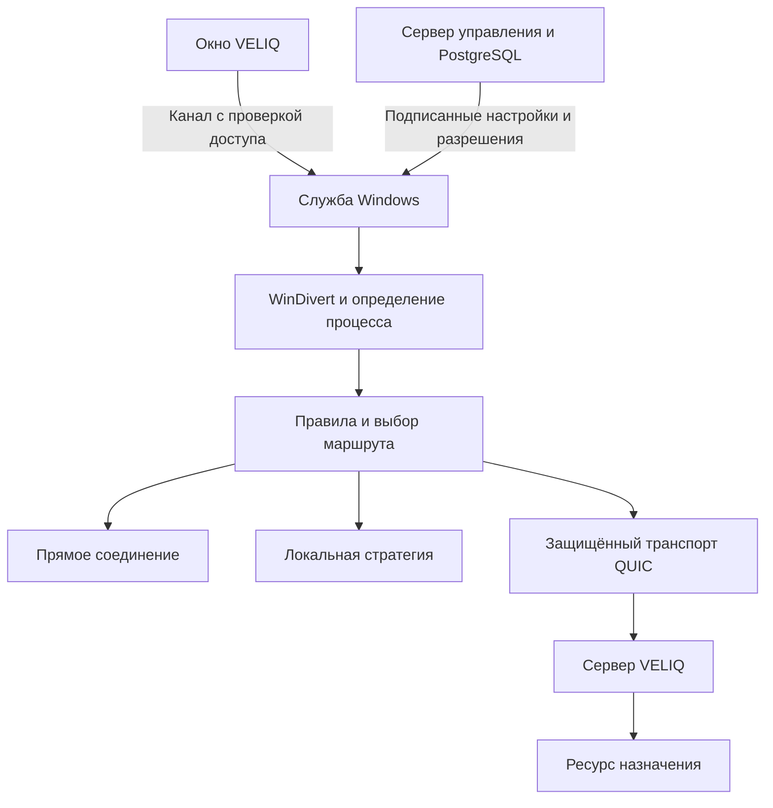

# Архитектура VELIQ

Интерфейс управляет службой, а служба выбирает маршрут для соединений конкретных процессов. Пользовательский интерфейс не пересылает пакеты и не требует прав администратора.

## Границы компонентов

`core` содержит переносимое ядро: протокол, транспорт, правила, профили, измерения и проверку подписей. Windows-часть отвечает за захват, достоверное определение процесса, права доступа и взаимодействие со службой. Интерфейс WPF показывает состояние, полученное от службы.

Сервер управления хранит устройства и подписки, выдаёт подписанные настройки и билеты для защищённого транспорта. Он находится вне пути пользовательского трафика. Релей обслуживает разрешённые соединения после проверки устройства и билета; он не заменяет сервер управления.

## Выбор маршрута

Маршрут определяется для нового соединения. Установленные TCP- и UDP-потоки закреплены за выбранным путём; обновление правил не переносит их на другой внешний адрес. Неизвестное назначение не считается доказанно недоступным.

Для игровых соединений используются прямой маршрут и локальные стратегии. Релей для игр сейчас не применяется. Для остальных сервисов возможность защищённого маршрута зависит от правил. Защищённые сервисы при отказе разрешённого пути не должны переходить на прямое соединение.

## Защита состояния

Служба и интерфейс используют разные права. Изменение настроек требует штатной авторизации IPC. Обновление должно сохранять идентичность устройства, владельца установки, профили и пользовательские настройки. Проверки TLS, подписей и защиты от повторного использования разрешений обязательны.

Подробности: [безопасность](SECURITY.md), [протокол](PROTOCOL.md), [статус и границы проверок](docs/STATUS.md).
